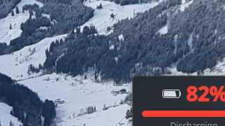

# GoodWe Battery Widget for KDE Plasma 6

A KDE Plasma 6 desktop widget that displays the battery state of charge from a GoodWe solar inverter on your local network.

- Shows battery percentage with a progress bar
- **Green** when charging, **red** when discharging
- Updates every 30 seconds
- Configurable inverter IP address



## Supported Inverters

Works with GoodWe hybrid inverters that have a battery and a WiFi module (HF-LPT230), including:

- ET series (e.g. GW10K-ET)
- EH series
- BH/BT series
- ES/EM series

The widget communicates with the inverter over UDP on your local network using the [goodwe](https://pypi.org/project/goodwe/) Python library.

## Requirements

- KDE Plasma 6
- Python 3
- The inverter must be connected to your local WiFi network

## Installation

```bash
git clone https://github.com/radekvokal/goodwe-battery-widget.git
cd goodwe-battery-widget
chmod +x install.sh
./install.sh
```

The install script will:

1. Install the `goodwe` Python package (user-level)
2. Install the `goodwe-battery-status` helper script to `~/.local/bin/`
3. Install the Plasma widget via `kpackagetool6`

### Add to Desktop

1. Right-click your desktop
2. Select **Add Widgets...**
3. Search for **GoodWe Battery**
4. Drag it onto your desktop

### Configure

Right-click the widget on your desktop and select **Configure GoodWe Battery...** to set the IP address of your inverter.

The default IP is `192.168.0.22`. You can find your inverter's IP by checking your router's connected devices list or scanning your network.

## Uninstallation

```bash
./uninstall.sh
```

## How It Works

The widget runs a small Python script every 30 seconds that queries the GoodWe inverter via UDP (port 8899) using the Modbus protocol. The script returns battery state of charge, charging/discharging status, voltage, and temperature as JSON. The widget displays the percentage and uses color to indicate the current mode.

## License

GPL-3.0+
